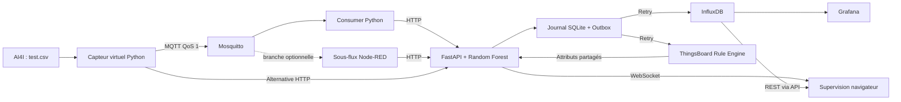

# Architecture et choix de conception

## Mesure, score et décision

Le modèle reçoit Type, température ambiante, température processus, vitesse, couple et usure. Le transformeur ajoute l’écart thermique et la puissance mécanique. La cible et les cinq modes de panne sont exclus des entrées. Un identifiant de ligne est conservé pour la traçabilité, mais n’entre pas dans le modèle.

Le score est distinct de la règle métier. Le seuil critique par défaut vaut 0,7 et utilise une comparaison stricte. L’état CRITICAL est maintenu jusqu’à trois observations consécutives strictement sous 0,5. Une valeur égale à 0,5 remet le compteur de retour à zéro. Les changements de configuration affectent les prochains messages.

## Livraison et idempotence

MQTT QoS1 permet des doublons. Le service conserve durablement l’identifiant et l’empreinte du contenu ; une retransmission identique ne recalcule pas le score et ne fait pas avancer le compteur de retour. Un contenu différent avec le même identifiant produit un conflit.

Le consumer acquitte la mesure MQTT après l’acceptation par le journal. En cas d’erreur HTTP temporaire, il réessaie le même contenu. Les messages définitivement invalides sont archivés dans `runtime/rejected.jsonl`, puis acquittés pour ne pas bloquer le flux.

L’événement, l’état d’alarme et les livraisons à effectuer sont enregistrés dans une transaction SQLite. L’outbox traite les événements par ordre de réception ; après un échec, les autres événements de cette destination attendent. Une destination en panne ne bloque pas l’autre. Les intégrations restent désactivées en mode Python minimal.

InfluxDB reçoit un timestamp stable lors des retries. ThingsBoard reçoit le même timestamp de télémétrie, et sa règle crée ou actualise une alarme du même type. Il ne s’agit pas d’une transaction distribuée ni d’une garantie globale exactement une fois : un crash entre livraison et suppression de l’outbox peut provoquer une nouvelle livraison.

## Temps et historique

AI4I n’a pas de temps de mesure physique exploitable dans cette démonstration. `measured_at=null` le rend explicite. Les courbes représentent le rejeu selon `received_at`. InfluxDB conserve également le JSON complet pour restituer le contrat via l’historique REST. Les tags sont la source simulée et la version du modèle ; l’identifiant de message reste un champ pour limiter la cardinalité.

Le journal SQLite conserve la déduplication et permet une démonstration sans services externes. InfluxDB fournit le stockage temporel demandé et la source de Grafana. Une API REST distincte expose la lecture de chaque source.

## Exploitation et limites

Les clients WebSocket lents ont une file de 100 messages ; les plus anciens sont remplacés lorsque la file est pleine. L’historique REST permet un rattrapage des derniers points après reconnexion, sans garantie de livraison de chaque notification WebSocket.

La configuration de démonstration expose seulement localhost, sans authentification applicative. Un déploiement partagé nécessiterait authentification, TLS, contrôle des droits, secrets externes, politique de sauvegarde et rétention. Ces fonctions ne sont pas prétendues implémentées dans cette version pédagogique.
