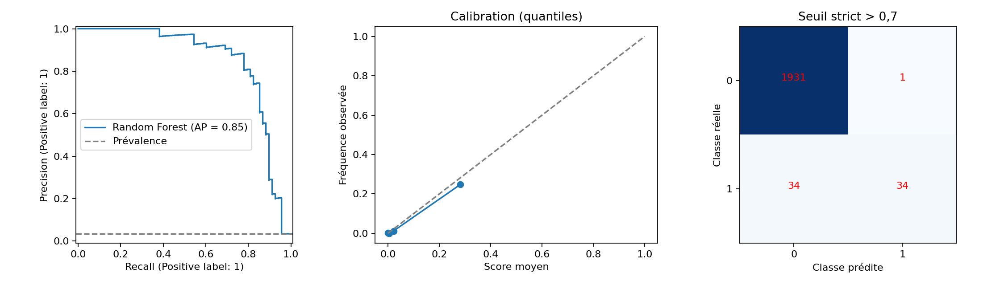

# Rapport de performance ML

Modèle : `rf-ai4i-dc6630cd9b`. Split : 6 000 / 2 000 / 2 000, graine 42.

| Politique | Précision | Rappel | F1 | TN / FP / FN / TP |
|---|---:|---:|---:|---|
| Toujours sain | 0.000 | 0.000 | 0.000 | [1932, 0, 68, 0] |
| Seuil 0,5 | 0.904 | 0.691 | 0.783 | [1927, 5, 21, 47] |
| Seuil métier 0,7 | 0.971 | 0.500 | 0.660 | [1931, 1, 34, 34] |
| Seuil validation 0.39 | 0.855 | 0.779 | 0.815 | [1923, 9, 15, 53] |

Average Precision : 0.8497 ; ROC-AUC : 0.9596 ; Brier : 0.0116.

Le seuil 0,7 respecte la consigne, mais peut manquer des défaillances. Le seuil exploratoire optimise F1 sur validation uniquement. Aucun réglage ne repose sur le test.

- Données synthétiques.
- Classification de la panne courante, aucun horizon futur.
- Split stratifié aléatoire : pas de preuve de généralisation temporelle ou à une autre usine.
- Score non calibré ; courbe de calibration fournie.

Variables utilisées : Type, températures, vitesse, couple, usure, écart thermique et puissance mécanique. Les identifiants, la cible et les cinq modes de panne sont exclus des features.